# Web interface

**Deutsch: [WEB-INTERFACE.de.md](WEB-INTERFACE.de.md)**

The container has a small web interface: which batteries talk to it, whether
they do it on time, whether the *endpoint itself* was running, and a file you
can attach to a bug report. Nothing to install, no extra dependency: it is part
of the same container, on port **8443**.

> Community project. Not affiliated with, endorsed by or supported by Marstek.
> The pictures below show invented devices and addresses; each one is the light
> and the dark theme of the same page.

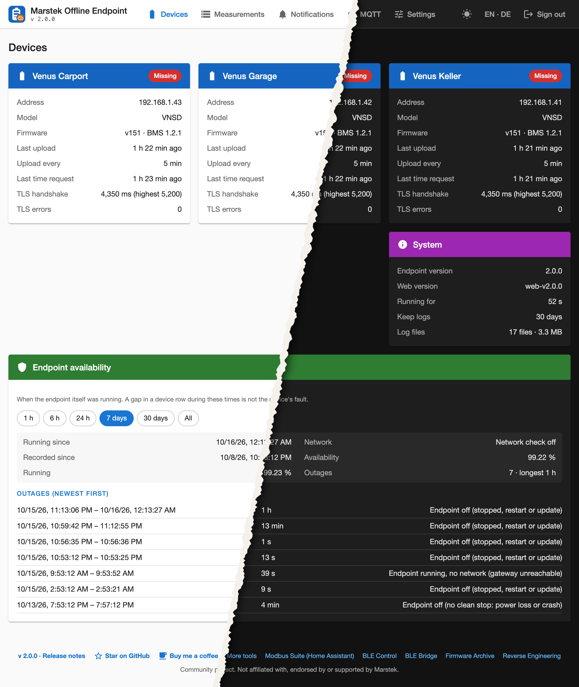

## First start and login

1. Start the container and read the one-time setup code from its log. It is
   printed only there, never in the interface:

   ```bash
   docker logs marstek-offline-endpoint 2>&1 | grep SETUP
   ```

2. Open `https://<host>:8443/`. The certificate is self-signed, so the browser
   warns once. Enter the code and choose a password (at least 8 characters).
3. There is **one account**. Forgot the password? Delete `auth.json` in the data
   folder; the next visit asks for a new setup code. No restart needed.

Login handling follows the OWASP guidance: scrypt for the password, a session
cookie that is `HttpOnly`, `SameSite=Strict` and `Secure` over HTTPS, a CSRF
token on every change, an idle timeout of 30 minutes and a limit of 12 hours,
and a lockout after 5 failed attempts per address within 15 minutes. The settings
page shows your last sign-in and the failed attempts since.

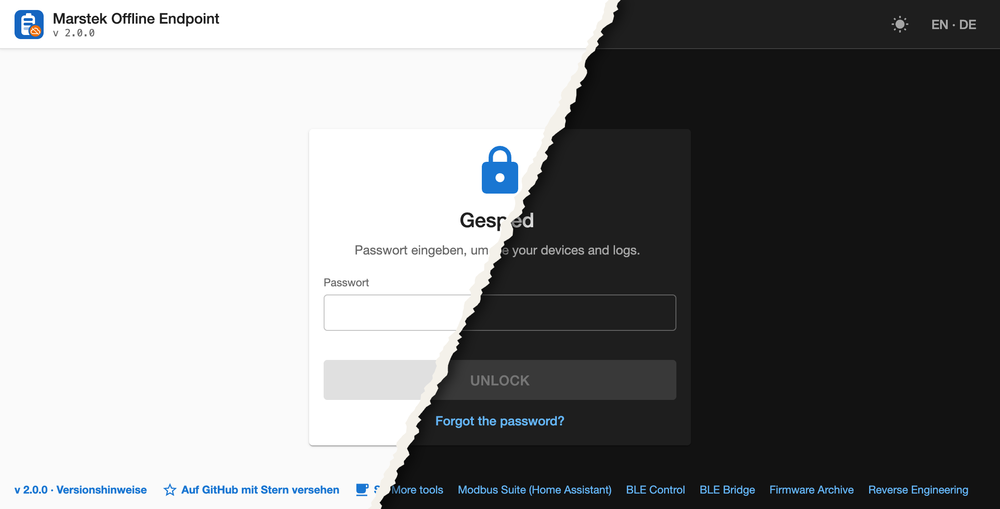

## Devices

Devices are recognised, not configured: the upload URL carries the device id,
the time request carries the firmware versions, and the upload body carries the
serial number (the MAC address). A device that gets a new address shows up under
the same id; one that talks again after being removed reappears.

- **Overview**: address, firmware, last upload and time request, usual rhythm,
  TLS handshake time, TLS errors, and whether the ping is answered.
- **Device page**: name (rename in a dialog), all identifiers, and below them the
  history.
- **Remove** a device (its log files stay until the retention time runs out) or
  **merge** one into another, for a board that was replaced and now reports a new
  id. A merge cannot be undone.

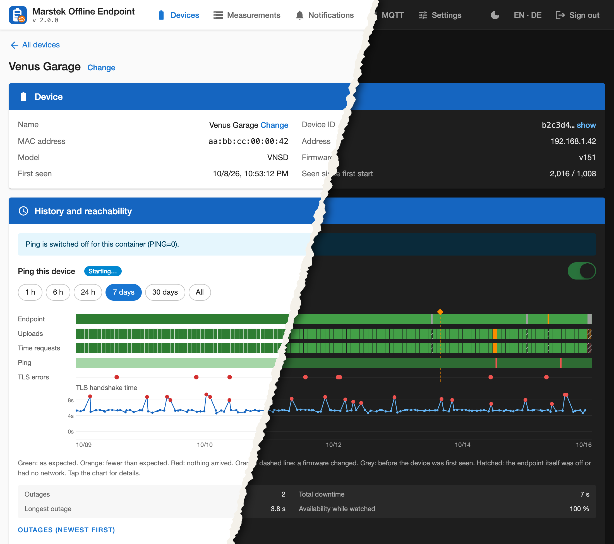

### History and reachability

One chart per device, from one hour to everything kept:

| Row | Shows |
|---|---|
| Endpoint | when the endpoint itself was running (see below) |
| Uploads, Time requests | received against expected: green as expected, orange fewer, red nothing |
| Ping | the device answered ping; red marks a dropout of 2.5 s or more |
| TLS errors | one dot per failed handshake |
| TLS handshake time | per connection; slow ones stand out in red |

Tap or click the chart for the details at that moment. Times when the endpoint
itself was off or without network are hatched across the device rows, because a
gap there is not the device's doing.

The ping runs from inside the container, one `ping` per device, and only writes
changes. It can be switched off per device, or for everything with `PING=0`.

## Endpoint availability

Telling "the battery was gone" from "my endpoint was gone" needs the endpoint to
write down its own life, so it does:

- a heartbeat every 30 s; at the next start it knows whether the last run ended
  cleanly (restart or update) or not (power loss, crash, `kill -9`);
- every 5 s a ping to the gateway of the network the batteries are on (the
  interface whose subnet holds their addresses; without known devices, the default
  route). Three misses in a row count as "no network", dated to the first miss. A
  gateway that never answers ping stays "unknown" and writes nothing. If that
  network has no default route (see the macvlan note below) the check stays off
  rather than watch the wrong network. `ENDPOINT_GATEWAY` overrides the address.

The overview card lists the outages with their cause and the share of time. The
record starts when this feature was first started; there is nothing for earlier.

## Measurements

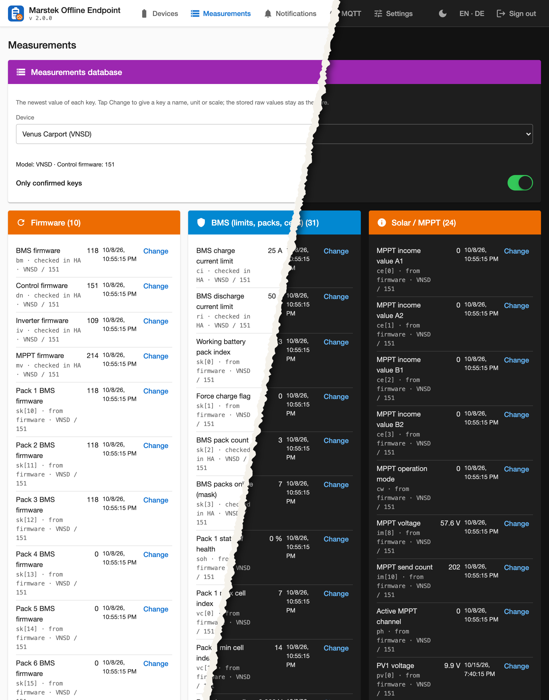

Next to the history of *when* a battery talked, the endpoint keeps *what* it said. Every
upload is decoded and the values that **changed** go into a SQLite file,
`measurements.db` in the data folder: one row per value, with the time, the device and
the raw text as uploaded. A value that stays the same adds nothing, so a quiet battery
costs little. Lists such as the cell voltages become one key per position
(`vc[2]`, `vc[3]`, ...). The device id and serial are not stored as values.

The page **Measurements** shows the newest value of every key per device, **grouped by
category** (firmware, power, energy, battery, temperature, grid and meter, solar/MPPT, status,
errors, connection, device). Tap a name for its **curve** over 24 hours to everything kept,
with the firmware changes marked as dashed lines. A separate card lists the **firmware
history**: when the control, BMS, inverter or MPPT firmware changed (a component that answers
0 counts as a gap, not as a version). The device page chart marks the same changes.

Almost every key has a meaning now. The badge says where it comes from: *checked against Home
Assistant* (counters and states compared to the Modbus values of three Venus D on firmware
151) or *from the firmware code* (the upload is a single `sprintf`; each argument is a copy of
a named live variable of control firmware 151). The firmware code gives the meaning, not always
the unit: where it does not, the unit stays empty and the raw value is shown. Keys that are
sent only by some firmware versions are noted in their description (`p_sta`, `p_pow` from
control 151; `pv`, `sk`, `mv`, `me`, `ma`, `fu` not by the VNSE3). `hd` is still unknown.

The interesting part is the **name field**: each key has a name, a unit and a scale that you
can change with *Change*. They are applied when reading, the stored values are never
touched, so a correction later fixes every old value at once. The filter shows only keys with a confirmed meaning by default; switch it off to see
every key, including ones that only appeared in a firmware you have not seen documented.

**Model and firmware.** A different model or firmware may send other keys or mean something
else by one. The database therefore records the device model and the control firmware (`dn`)
with every value. The model comes from the time request (`VNSD-0` is a VNSD, a Venus D;
`VNSA` is a Venus A; `VNSE3` a Venus E 3.0); the page shows it on the device. A meaning can
be set for *everything*, for *one firmware*, for *one model* or for *one model with one
firmware*. The most specific rule wins: model with firmware, then model, then firmware, then
everything. A rule leaves the others as they are; saving a broader one also replaces the
narrower ones inside it.

The built-in meanings were verified on a Venus D with firmware 151 and are marked that way.
For every other model or firmware they carry over by name but are shown as not verified, and
the page says so. Where the firmware code of another model or version feeds a key from a
different variable, the built-in list has a separate rule for that model (the Venus E 3.0
sends the voltage of 16 cells of pack 1 in `vc`, not the min/max statistics of six packs).
The differences found in ten decompiled control firmwares are listed in the reverse-engineering
repository, and `docs/NEW-FIRMWARE.md` describes how to check a new version. After a
firmware change every value is written once more under the new firmware.

- **Switch** it off under *Settings -> Measurements database*. Nothing is recorded then,
  and what is stored stays.
- **Retention** follows the log retention; the newest value of each key is always kept.
- **Rebuild from the logs** empties the readings and fills them again from the request
  logs (your names stay). This also happens by itself the first time, so a new database
  starts with the history you already have.
- **Size:** about 19 MB for 12 days of three batteries, since power and voltage change
  with nearly every upload. Slow values cost almost nothing.
- The **support package** can include the values as `measurements.csv` per device
  (an option, off by default). Device ids, serials and addresses are masked as usual.
- It needs Node 22 (`node:sqlite`); the container image has it. Without it the card says
  so and nothing else changes.

## Notifications

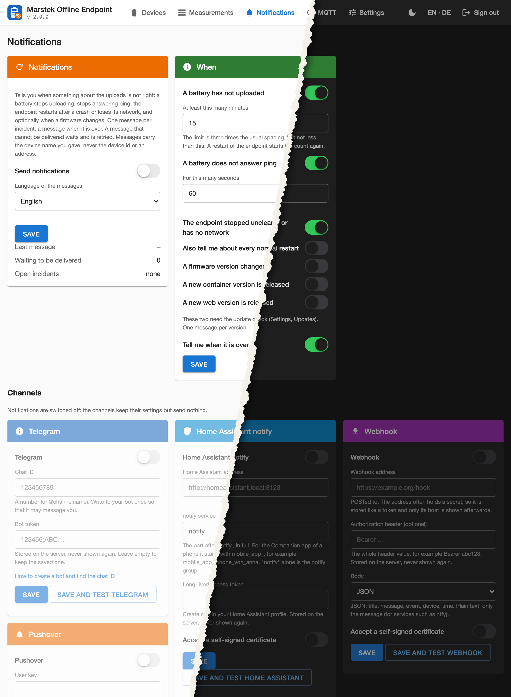

The endpoint can tell you when something about the uploads is not right. Set it up on the page
**Notifications**: one card with the main switch and the status, one with the rules, and one card per
channel. Nothing is sent until you switch it on and add a channel. The main switch is a pause button: while it is off, the channels keep their settings but send nothing (they appear dimmed). Switching a channel on also switches the main switch on.

| When | Default |
|---|---|
| A battery has not uploaded for three times its usual spacing (at least 15 minutes, adjustable) | on |
| A battery has not answered ping for 60 seconds (adjustable) | on |
| The endpoint started after an unclean stop (power loss, crash), or has no network | on |
| The endpoint restarted normally | off |
| A firmware version changed (control, BMS, inverter, MPPT) | off |
| The incident is over | on |

One message per incident, one more when it is over. A restart of the endpoint starts the upload
count again, so a restart is never reported as a missing upload, and an incident that is
still open is not reported again after a restart. A message that cannot be delivered (for
example while the endpoint has no network) waits and is retried every minute for up to 24
hours; at most 30 messages per hour leave the container.

Channels (Telegram, Pushover, Home Assistant notify, webhook):

- **Telegram:** create a bot with @BotFather, write to it once, enter its token and your chat
  ID (step by step: [TELEGRAM.md](TELEGRAM.md)). The endpoint calls `api.telegram.org`.
- **Pushover:** create an application at pushover.net/apps and enter its API token and your user key
  (or a group key). A priority can be chosen: quiet, normal, high (high ignores quiet hours). The endpoint
  calls `api.pushover.net`.
- **Home Assistant notify:** enter the address of your Home Assistant, a long-lived access token
  (profile page) and the notify service, for example `mobile_app_iphone` for the app on a phone.
  The endpoint calls `POST /api/services/notify/<service>`.

- **Webhook:** a POST to any URL, for services such as ntfy, Gotify, Slack, Discord or your own script.
  Body as JSON (`title`, `message`, `event`, `device`, `time`) or as plain text (the message only, with the
  title as a `Title` header). The address often holds a secret, so it is stored like a token and the page
  shows only its host afterwards. An `Authorization` header can be added. `event` is one of `upload_missing`,
  `upload_back`, `ping_down`, `ping_up`, `endpoint_unclean_start`, `endpoint_restart`, `network_down`,
  `network_up`, `firmware_changed`, `test`.

"Save and test" sends a test message through the channel. A message names the device as you named it
(or "Venus" plus the last four characters of its MAC); it never contains a device id, an address
or a measurement. The language of the messages is a setting of its own. Tokens are kept in
`secrets.json` in the data folder (readable by the owner only), are never shown again by the
page and are never part of a support package.

## MQTT for Home Assistant

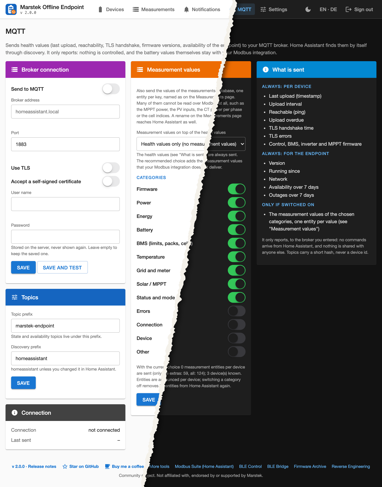

On its own page, **MQTT**, the endpoint can send health values to your MQTT
broker. Home Assistant finds them by itself through MQTT discovery (prefix `homeassistant`), no YAML
needed:

- per device: last upload (timestamp), upload spacing, reachable (ping), upload overdue,
  TLS handshake time, TLS errors, and the four firmware versions;
- for the endpoint: version, running since, network, availability and number of outages over 7
  days.

**Measurement values (option, off by default).** The endpoint can also send the values of the measurements
database as well, one Home Assistant entity per key, named as on the Measurements page (a rename there
reaches Home Assistant too). Many of these cannot be read over Modbus at all: the MPPT power and voltage,
the four PV inputs, the CT power per phase, grid import and export of the meter, the cell indices, the pack
error words and more. Choose *Health values only*, *Add the measurement values Home Assistant does not get over Modbus* (recommended: it
leaves out the keys that were matched to Modbus values) or *Add all measurement values*, and pick the categories. The health values are sent in every case. Values
arrive in one JSON message per device; numbers carry unit, device class and state class (power, energy,
voltage, current, temperature), hex fields arrive as `0x..` text. The address and the device clock are
never sent. Switching a category or the whole option off removes its entities from Home Assistant
again. The dropdown shows in brackets how many entities per device each choice creates. A fourth choice, *Add only the values I pick*, lets you choose single values on the Measurements page: a checkbox *MQTT* on every row (and *all / none* for a whole card). Every value that is sent is marked with a small arrow symbol on its row, in every mode.

Everything goes to the broker you entered and to nobody else. An availability topic with a last will makes the entities go "unavailable" when the endpoint is
gone. Topics carry a short hash instead of the device id. It only reports: nothing arrives from
Home Assistant, nothing controls a battery, and the battery values themselves (state of charge,
power, ...) are not sent, because Home Assistant already reads them over Modbus. The MQTT client is
part of the endpoint (MQTT 3.1.1, plain or TLS, user and password), so there is nothing to
install. The password is kept like the tokens above.

## Two processes, and web updates

The container runs two processes. The **main process** (`server.cjs`) answers the batteries on ports 443 and 80, writes the
daily request logs and keeps the record of the endpoint's own life (heartbeat, network check). The **web process**
(`webproc.cjs`) runs this web interface, the measurements database, the notifications, the MQTT client and the ping. The main
process starts it, feeds it what happens at the endpoint and restarts it when it stops.

What this buys you: restarting or updating the web side does not touch the endpoint that answers the batteries. A restart of
the web process takes a second or two, you stay signed in (sessions are kept in `sessions.json`, under a hash), events that
arrive meanwhile are queued, and the "endpoint availability" does not count it as an outage because that record is kept by the
main process. The support package's console log still contains the main process's lines.

### Updating the web interface only

The Updates card shows two kinds of releases: **container** releases (`vX.Y.Z`: a new image, which you pull as before) and
**web** releases (`web-vX.Y.Z`: a new web side). A web update is installed from the page, without a new image and without a
restart of the endpoint:

1. A release `web-vX.Y.Z` carries three files: `marstek-endpoint-web-X.Y.Z.tar.gz`, `.manifest.json` and `.manifest.sig`.
2. **Press "Install".** Nothing is ever installed by itself; the update check only reads release notes.
3. The endpoint downloads the three files (from github.com only, over HTTPS), checks the **Ed25519 signature** of the manifest
   against the public key that is part of the image (`webupdate.pub`), checks the SHA-256 of the archive against the manifest,
   checks what the manifest asks for (see below), reads the archive with a small reader that accepts only the listed plain
   file names (no links, no `..`, no extra files) and writes the files to `data/web-override/X.Y.Z/`.
4. Only then is it made current and the web process restarts. Anyone who can publish a release on GitHub but does not hold the
   private key cannot make an endpoint install anything.
5. If the new version does not start, the main process marks it as failed after three crashes within a minute and the web side
   runs the files of the image again; the card says so. "Go back to the version in the image" does the same by hand.

**Minimum versions.** The manifest carries `requires.minContainer` (the oldest image the web side works with) and
`requires.ipc` (the version of the conversation between the two processes). The page shows what a release needs before you
press anything, and the install refuses a release that does not fit ("needs container X or newer: update the image first").
The requirement is checked again every time the web process starts, so an update that no longer fits a newer or older image is
not used. An installed update is also ignored as soon as the image carries a newer or equal web version.

The new version numbers are shown as `web-vX.Y.Z` next to the container version. Notifications can tell you about new container
versions and new web versions (Notifications page, rules; both off by default).

What still needs a new image (a container restart): `server.cjs` itself, the supervisor, Node and Alpine, the certificates and
the environment variables (ports, proxy). Publishing web releases is described in `docs/RELEASING.md`.

## Settings

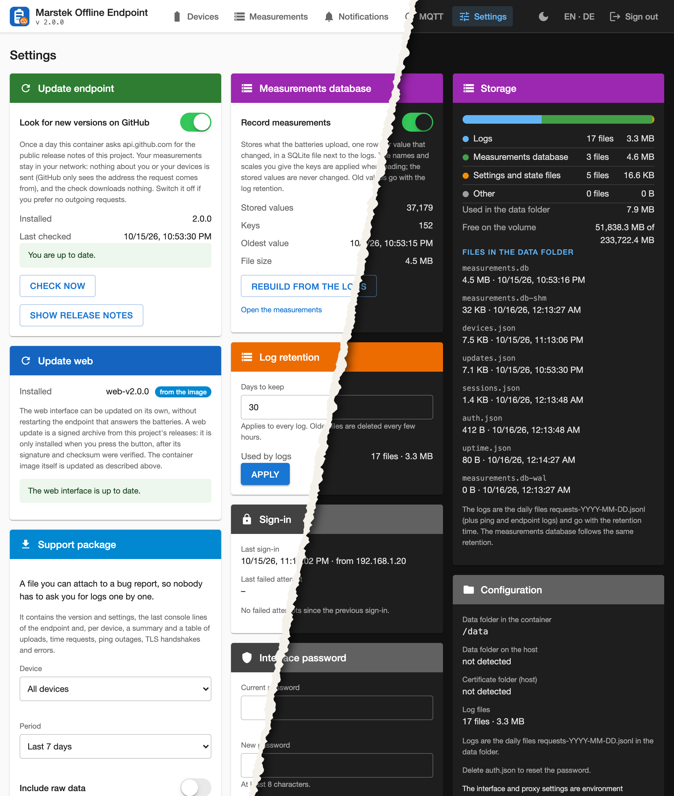

- **Updates**: once a day the container asks `api.github.com` for the public
  release notes of this project and shows what is new. Only the request itself
  leaves the network (GitHub sees the address it comes from); nothing about your
  devices is sent and nothing is downloaded or installed. On by default; switch
  it off if you want no outgoing requests.
- **Measurements database**: on/off, what it holds, rebuild from the logs (see above).
- **Log retention**: one value for all logs, 30 days by default.
- **Support package**: see below.
- **Sign-in and password.**
- **Storage:** what the data folder holds by kind (logs, measurements database, settings and
  state files, other) as a bar and a table, the free space of the volume and the list of files
  with size and date.
- **Configuration:** where things are (data folder in the container and on the host, certificate
  folder), how to reset the password (`auth.json`) and which settings come from the environment.

### Support package

A `.tar.gz` for a bug report, for all devices or one, for 24 hours up to
everything kept: version and settings, the last console lines, a table of
uploads, time requests, ping dropouts and TLS events per device, and the
endpoint's own outages.

By default the package is **masked**: device ids, serial numbers, IP addresses
and names become `device-1`, `mac-1`, `ip-1`, and no request bodies are
included. **Tokens and e-mail addresses are always removed**, also when you tick
"Include raw data", which adds the request lines with the real identifiers. Look
through the file before you attach it.

## Phone

The layout follows the screen: a burger menu, a compact chart you can tap, and
the same pages. The menu also holds the language, the appearance and the links.

| | | |
|---|---|---|
| 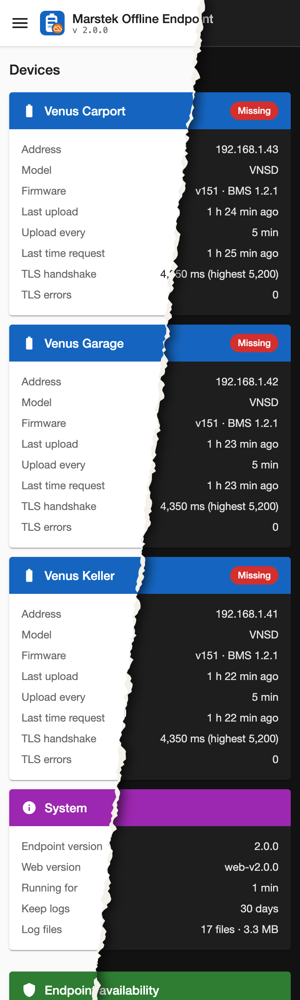 | 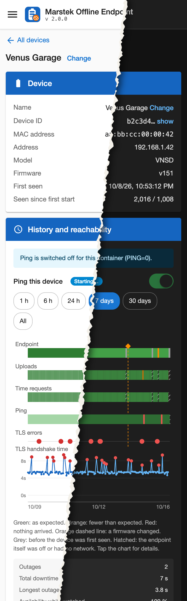 | 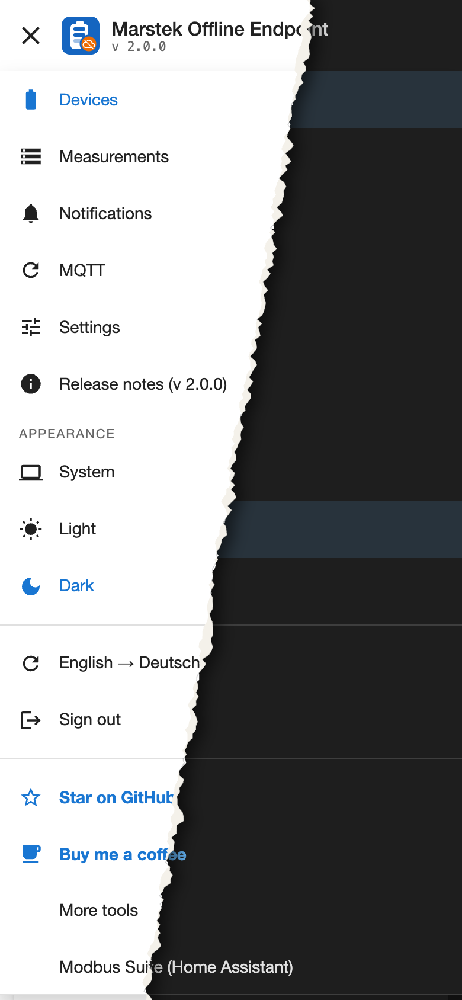 |
| 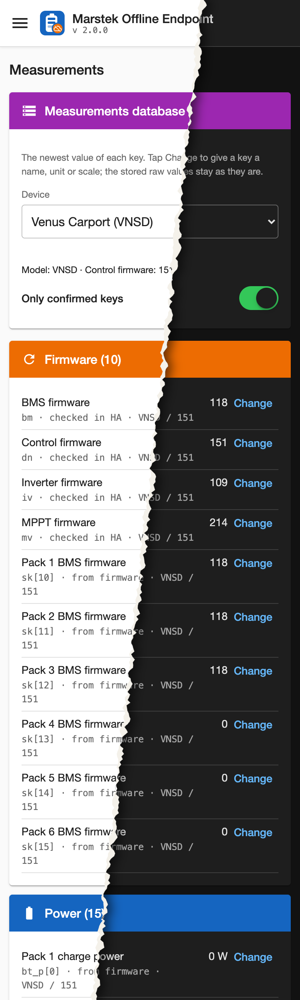 | 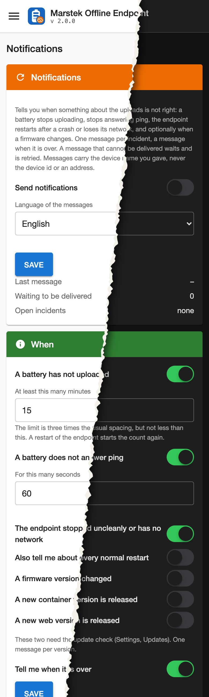 | 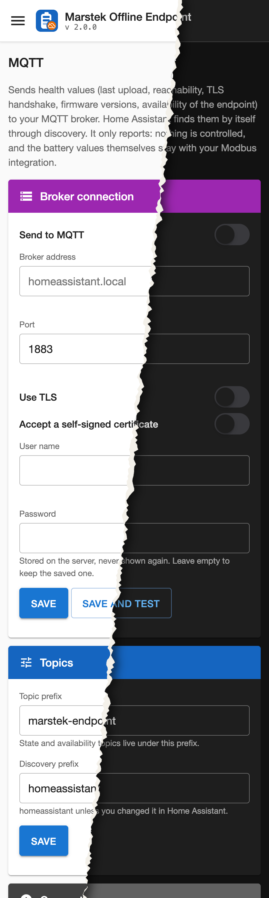 |

## Light, dark and system

The button in the top bar (a monitor, sun or moon, matching the current choice)
opens a small menu: **System** follows your device, **Light** and **Dark** are
fixed. The choice is remembered in the browser and already applies on the login
page.

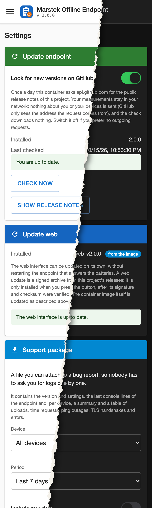

## Behind a reverse proxy

Everything about the listener is set by environment variables, on purpose: a
wrong value in the interface could lock you out of it.

| Variable | Default | Meaning |
|---|---|---|
| `WEB_PORT` | `8443` | port of the interface; `0` switches it off |
| `WEB_TLS` | `1` | `0` serves plain HTTP, for a proxy that terminates TLS **and** a trusted network |
| `BASE_PATH` | — | serve under a prefix, e.g. `/endpoint` |
| `TRUST_PROXY` | — | comma-separated addresses or IPv4 networks (`172.18.0.0/16`) whose `X-Forwarded-*` headers are believed. Without it the interface sees the proxy's address for every visitor, so the lockout counts everyone together and the last sign-in shows the proxy |
| `PING` | `1` | `0` turns off the device ping and the gateway check |
| `ENDPOINT_GATEWAY` | — | address to ping for the network check instead of the devices' gateway |

Keep TLS on, also behind the proxy, unless the two sit on the same host and you
have a reason not to: the login must never cross a network in clear text.

### The macvlan catch

The batteries need the endpoint on port 443. If your proxy already holds 443,
the endpoint needs an address of its own, and the usual way is a **macvlan**
network. Docker does not let the host, and so the proxy on the same host, reach
a macvlan container. Give the endpoint a second network that the proxy shares,
and keep the default route on the LAN:

```yaml
services:
  marstek-offline-endpoint:
    environment:
      TRUST_PROXY: "172.18.0.0/16"        # the subnet of the "proxy" network
    networks:
      endpoint_lan:
        ipv4_address: 192.168.1.231
        gw_priority: 1                    # default route stays on the LAN (Docker 28+)
      proxy: {}

networks:
  proxy:
    external: true
  endpoint_lan:
    driver: macvlan
    driver_opts:
      parent: eth0
    ipam:
      config:
        - subnet: 192.168.1.0/24
          gateway: 192.168.1.1
          ip_range: 192.168.1.231/32
```

Without `gw_priority` the default route may end up on the proxy network. The
network check then switches itself off (the log says why), and the update check
would go out through the proxy network. On an older Docker make sure the LAN
network sorts first, or set `ENDPOINT_GATEWAY`.

Traefik, as a file route (the self-signed certificate of the interface is
accepted on the hop inside the host; `lan-only` stands for an allow-list of your
own networks):

```yaml
http:
  routers:
    endpoint:
      entryPoints: [websecure]
      rule: "Host(`endpoint.example.org`)"
      middlewares: [lan-only@file]
      service: endpoint
      tls: {}
  services:
    endpoint:
      loadBalancer:
        passHostHeader: true
        serversTransport: endpoint-selfsigned@file
        servers:
          - url: "https://marstek-offline-endpoint:8443"
  serversTransports:
    endpoint-selfsigned:
      insecureSkipVerify: true
```

Nginx Proxy Manager and Caddy work the same way: forward to
`https://marstek-offline-endpoint:8443` with certificate verification off for
that one upstream.

**Keep it off the internet.** The interface lists your devices and their
addresses. Restrict the proxy route to your own network, as above.
